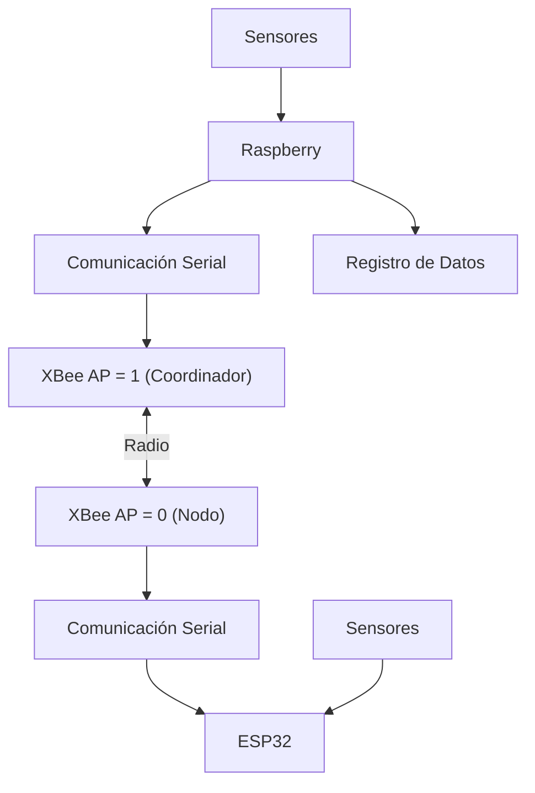
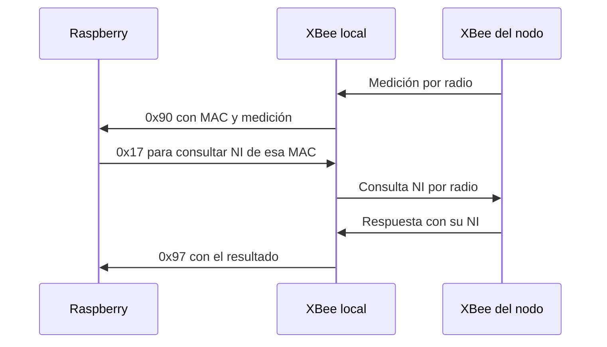

# Comunicación XBee: ESP32 y Raspberry Pi

**Cada XBee se conecta por un puerto serial UART a su equipo: la ESP32 o la Raspberry.** `AP` define cómo se organizan los datos intercambiados por esa conexión:

- **AP=0:** el equipo intercambia directamente los datos, por ejemplo un JSON.
- **AP=1:** el equipo intercambia tramas API, que incluyen los datos y campos de control.



Los enlaces seriales y de radio permiten comunicación en ambos sentidos. Las mediciones del nodo viajan desde la ESP32 hacia la Raspberry. «Coordinador» y «Nodo» indican su función en este montaje; `AP` define el modo de la interfaz serial.


###  Ejemplo del contenido que queremos transmitir:

```json
{"nivel":500,"codigo":"667"}
```

| AP del XBee de la ESP32 | AP del XBee de la Raspberry | La ESP32 debe escribir | La Raspberry recibe |
|---|---|---|---|
| 0 | 0 | JSON | JSON |
| 0 | 1 | JSON | Trama `0x90` con el JSON y la MAC del emisor |
| 1 | 0 | Trama `0x10` con el JSON | JSON |
| 1 | 1 | Trama `0x10` con el JSON | Trama `0x90` con el JSON y la MAC del emisor |

Donde, los indicadores `0x10` y `0x90`significan: 

- **`0x10`: «Envía estos datos a este destino».** El equipo entrega esta solicitud a su XBee.
- **`0x90`: «Recibí estos datos de este emisor».** El XBee entrega este aviso al equipo conectado a él. Incluye los datos y la MAC del emisor.

La tabla supone `AO=0` en el receptor API. Los XBee pueden tener valores `AP` diferentes porque ese parámetro define el formato de la comunicación serial de cada XBee con su equipo. Entre los XBee, los datos viajan en paquetes de radio (RF).

**En nuestro montaje:** la ESP32 escribe el JSON directamente porque su XBee está en `AP=0`. Ese radio transmite los datos al XBee de la Raspberry, que está en `AP=1, AO=0` y genera una `0x90` para entregárselos a Python.

**Por eso la Raspberry recibe una `0x90` aunque la ESP32 no construya una `0x10`.** Cambiar el XBee del nodo a `AP=1` requiere adaptar el `main` para construir solicitudes `0x10`.

Si la Raspberry quiere enviar un dato a un nodo, Python construye una solicitud `0x10` con la dirección de destino y el dato, y la entrega a su XBee por el puerto serial.


## Estructura de una Trama API 

La estructura general de una trama API con `AP=1` es:

| Campo de la trama | Posición del byte | Descripción |
|---|---|---|
| Delimitador de inicio | 1 | `0x7E`: indica el comienzo de la trama. |
| Longitud | 2–3 | Dos bytes: primero el más significativo (MSB) y luego el menos significativo (LSB). Indican cuántos bytes contiene el campo «Datos de la trama». |
| Datos de la trama | 4–n | Identificador API y datos específicos de ese tipo de trama. |
| Suma de comprobación (checksum) | n + 1 | Un byte para comprobar la integridad de la trama. |

Las posiciones se cuentan desde 1; `n` es la posición del último byte del campo «Datos de la trama».


## Qué contiene «Datos de la trama» (Frame data)

Este campo contiene la información que el equipo y su XBee intercambian. Su estructura depende de la función de la trama y se divide en **identificador API (`cmdID`)** y **datos específicos de ese identificador (`cmdData`)**:

| Campo | Posición del byte | Contenido |
|---|---|---|
| Delimitador de inicio | 1 | `0x7E` |
| Longitud: byte más significativo | 2 | MSB |
| Longitud: byte menos significativo | 3 | LSB |
| Datos de la trama: identificador API | 4 | `cmdID`, por ejemplo `0x10` o `0x90` |
| Datos de la trama: datos específicos | 5–n | `cmdData`: campos propios de ese tipo de trama, como direcciones, opciones y datos de la aplicación |
| Suma de comprobación | n + 1 | Un byte |

Los valores que ocupan varios bytes se transmiten en formato **big endian**: primero el byte más significativo.

**El delimitador de inicio es `0x7E` para cada trama. `0x10` y `0x90`son identificadores API y ocupan el byte 4 e indican cómo interpretar los bytes siguientes. Algunos otros identificadores API son:**


### Nombres de tramas API e ID´s enviados al Módulo Xbee

| Nombre de la trama API | Identificador API |
|---|---|
| AT Command | `0x08` |
| AT Command - Queue Parameter Value | `0x09` |
| **TX Request — solicitud para transmitir datos** | **`0x10`** |
| Explicit TX Request | `0x11` |
| Remote Command Request | `0x17` |


### Nombres de tramas API e ID´s recibidos del dispositivo (Raspberry o Esp32)

| Nombre de la trama API | Identificador API |
|---|---|
| AT Command Response | `0x88` |
| Modem Status | `0x8A` |
| Transmit Status | `0x8B` |
| Route information packet | `0x8D` |
| Aggregate Addressing Update frame | `0x8E` |
| **RX Indicator (`AO=0`) — aviso de datos recibidos** | **`0x90`** |
| Explicit RX Indicator (`AO=1`) | `0x91` |
| Data Sample RX Indicator frame | `0x92` |
| Node Identification Indicator (`AO=0`) | `0x95` |
| Remote Command Response | `0x97` |

Las solicitudes son menores a  `0x80`; las de respuesta superiores a `0x80`.


## Ejemplo: solicitud `0x10` y recepción `0x90`

Para comparar ambos formatos, en este ejemplo **los dos XBee están en `AP=1`**, el receptor utiliza `AO=0` y el emisor tiene `TO=0xC0` para un envío unicast por DigiMesh con confirmación de radio. Las MAC de ejemplo son:

- Emisor: `0013A20041AEB54E`.
- Receptor: `0013A20012345678`.

El contenido que queremos transportar es el texto `TxData`, cuyos bytes son `54 78 44 61 74 61`. En la aplicación, el contenido puede ser el JSON de una medición.

**Los desplazamientos de las tablas siguientes se cuentan desde 0**, como en las capturas del manual. Por eso el identificador API está en el desplazamiento 3, que corresponde al byte 4 al contar desde 1.

#### `0x10`: el equipo le pide a su XBee que transmita

El programa emisor escribe esta trama completa por el puerto serial:

```text
7E 00 14 10 52 00 13 A2 00 12 34 56 78 FF FE 00 00 54 78 44 61 74 61 91
```

| Desplazamiento | Bytes | Campo | Valor del ejemplo |
|---|---|---|---|
| 0 | 1 | Delimitador de inicio | `7E` |
| 1–2 | 2 | Longitud de los datos de la trama | `00 14`: 20 bytes |
| 3 | 1 | Tipo API | **`10`** |
| 4 | 1 | Identificador de la solicitud (Frame ID) | `52` |
| 5–12 | 8 | MAC de destino | `00 13 A2 00 12 34 56 78` |
| 13–14 | 2 | Reservado | `FF FE` |
| 15 | 1 | Radio de difusión (broadcast radius) | `00` |
| 16 | 1 | Opciones de transmisión | `00`: utilizar `TO` |
| 17–22 | 6 | Contenido | `54 78 44 61 74 61`: `TxData` |
| 23 | 1 | Checksum | `91` |

El tipo **`0x10`** significa «transmite»; el Frame ID **`0x52`** identifica esta solicitud. El XBee envía el contenido al destino indicado.

#### `0x90`: el XBee receptor informa al equipo de lo recibido

Al recibir el paquete de radio, el XBee con `AP=1, AO=0` genera una trama `0x90` y la entrega al equipo conectado a él. Puede informar tanto de un envío unicast como de un broadcast. En un emisor que funciona en modo API, la solicitud de envío puede ser `0x10` o `0x11`.

Su estructura es:

| Desplazamiento | Tamaño | Campo | Descripción |
|---|---|---|---|
| 0 | 1 byte | Delimitador de inicio | `0x7E` |
| 1–2 | 2 bytes | Longitud | Cantidad de bytes del campo «Datos de la trama». |
| 3 | 1 byte | Tipo API | **`0x90`** |
| 4–11 | 8 bytes | Dirección de origen | MAC del XBee que envió el contenido. |
| 12–13 | 2 bytes | Reservado | Normalmente `0xFFFE`. |
| 14 | 1 byte | Opciones de recepción | Indican características del paquete recibido. |
| 15–n | Variable | Datos recibidos | Contenido recibido por radio. |
| n + 1 | 1 byte | Checksum | Comprobación de integridad. |


### Las opciones de recepción combinan según el posicionamiento de sus bits:

| Bit o bits | Valor | Significado |
|---|---|---|
| 0 | `0x01` | Se envió una confirmación de radio (ACK). |
| 1 | `0x02` | El paquete se recibió como broadcast. |
| 2–5 | Reservados | Sin uso en esta descripción. |
| 6–7 | `00`, `01`, `10` o `11` |b’00 = invalid option,                                                                                                                                 b’01 = Point-multipoint [0x40],                                                                                                                  b’10 = Directed Broadcast [0x80],                                                                                                              b’11 = DigiMesh [0xC0]
 

Estos valores pueden combinarse. Por ejemplo, **`0xC1 = 0xC0 + 0x01`** indica DigiMesh y confirmación de radio. Ese ACK corresponde al enlace entre radios.

Para el envío anterior, el equipo receptor recibe esta trama, que reproduce el ejemplo `0x90` de la captura:

```text
7E 00 12 90 00 13 A2 00 41 AE B5 4E FF FE C1 54 78 44 61 74 61 C4
```

| Campo | Valor | Interpretación |
|---|---|---|
| Delimitador de inicio | `7E` | Comienza una trama API. |
| Longitud | `00 12` | Hay 18 bytes en «Datos de la trama». |
| Tipo API | **`90`** | Aviso de datos recibidos. |
| Dirección de origen | `00 13 A2 00 41 AE B5 4E` | MAC del emisor. |
| Reservado | `FF FE` | Campo sin uso. |
| Opciones de recepción | `C1` | DigiMesh con ACK. |
| Datos recibidos | `54 78 44 61 74 61` | Texto `TxData`. |
| Checksum | `C4` | Comprobación de integridad. |

En ambos formatos, la longitud cuenta únicamente los bytes de «Datos de la trama», desde el identificador API hasta el último byte de contenido. El checksum se calcula como `0xFF - (suma de esos bytes & 0xFF)`. Así se obtienen `0x91` para el ejemplo `0x10` y `0xC4` para el ejemplo `0x90`.

**La `0x10` se construye para ordenar un envío y la `0x90` se genera para informar una recepción.** Los radios transportan el contenido en paquetes RF y cada XBee utiliza su configuración `AP` para intercambiarlo con su equipo por el puerto serial.

En nuestro montaje, el XBee de la ESP32 está en `AP=0`: la ESP32 escribe directamente el contenido y el XBee de la Raspberry genera la `0x90` al recibirlo. Si el envío del nodo es broadcast, la estructura `0x90` se mantiene y sus opciones indican broadcast mediante el bit 1.


## Envío por defecto a la red

Con `AP=0` y los valores de fábrica del XBee-PRO 900HP, `DH=0` y `DL=FFFF`, el destino es **broadcast**: los datos se envían a todos los dispositivos de la red. La Raspberry puede recibirlos sin que se configure su MAC como destino; los demás nodos también pueden recibirlos.

Para dirigir los mensajes exclusivamente al XBee de la Raspberry, en cada nodo se configura `DH` con el `SH` de ese XBee y `DL` con su `SL`. Ese cambio es opcional si se mantiene el envío por broadcast.

Referencia: [Digi — formato y tipos de tramas API](https://docs.digi.com/resources/documentation/digidocs/90002173/reference/r_api_frame_format_900hp.htm),  [XBee-PRO_900HP_XSC_RF_Modules.pdf](https://www.digi.com/resources/documentation/digidocs/pdfs/90002173.pdf), páginas 69 y 86–87.

## Solicitud NI

La Raspberry obtiene la MAC del emisor en la `0x90` y, si aún no conoce su `NI` (nombre del XBee), lo consulta con una `0x17`. El XBee del nodo responde por radio y el XBee local entrega el resultado en una `0x97`. La ESP32 no interviene y la recepción de mediciones continúa.


