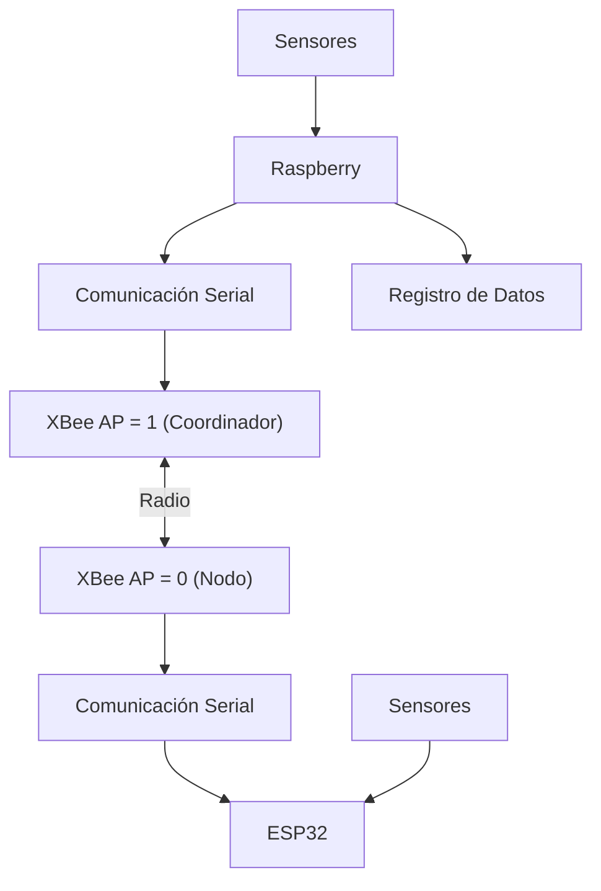
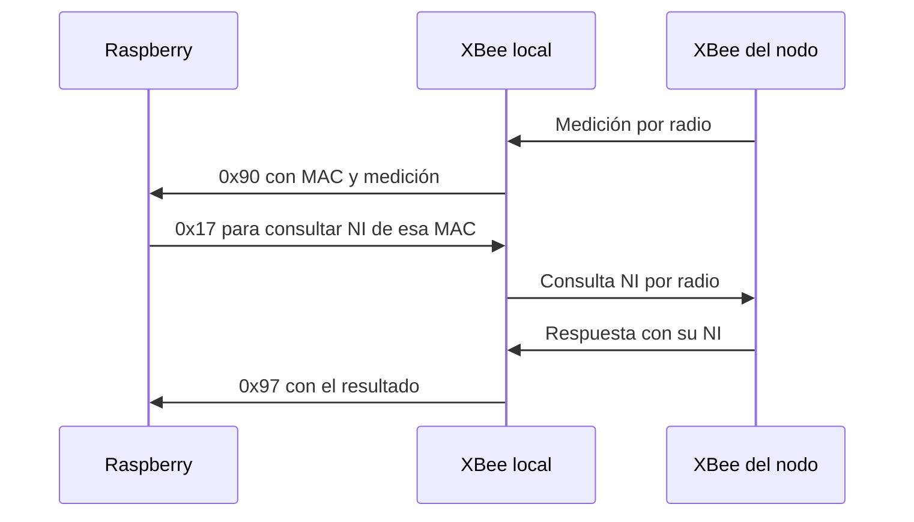

# CornareSAT_modular

## Índice

- [1. CornareSAT](#seccion-1)
- [2. Nueva configuración de la imagen](#seccion-2)
- [3. Comunicación XBee: ESP32 y Raspberry Pi](#seccion-3)

<a id="seccion-1"></a>
## 1. CornareSAT

<a id="seccion-1-1"></a>
### 1.1. Propósito del proyecto

CornareSAT es un sistema de adquisición, registro y transmisión de mediciones de nivel y precipitación. Reúne los datos de sensores locales y remotos para enviarlos a la infraestructura de almacenamiento y consulta del proyecto.

La Raspberry Pi funciona como estación central. Puede leer sensores locales, recibir mediciones de varios nodos mediante XBee, guardar los datos y publicarlos por MQTT. Los nodos remotos utilizan una ESP32 para obtener las lecturas de sus sensores y enviarlas por radio hacia la Raspberry.

Se desarrolló un programa modular en Python que reúne la medición de nivel y lluvia, la recepción XBee y la publicación de datos bajo la coordinación de `main.py`. Esta organización permite adaptar los sensores de cada estación y facilita el mantenimiento del código.

<a id="seccion-1-2"></a>
### 1.2. Componentes utilizados

| Componente | Función en el proyecto |
| --- | --- |
| Raspberry Pi | Coordinar la estación, leer sensores locales, recibir los nodos, guardar mediciones y enviarlas al servidor. |
| ESP32 | Obtener las lecturas de un punto remoto y preparar los mensajes que transmite su XBee. |
| XBee PRO 900HP DigiMesh | Comunicar por radio los nodos remotos con la estación central. |
| Sensores MaxBotix | Proporcionar las lecturas utilizadas para la medición de nivel. |
| Pluviómetro RG-15 | Proporcionar las lecturas de precipitación del sensor local de lluvia. |
| Adaptadores USB a serial | Conectar a la Raspberry el receptor XBee y los sensores que usan comunicación serial. |
| ADS1015 e INA219 | Apoyar, respectivamente, la lectura analógica de nivel y la medición de parámetros eléctricos de la estación. |

La Raspberry ejecuta el programa en Python dentro de un entorno virtual. Las ESP32 utilizan su firmware de adquisición y transmisión. El intercambio de mediciones utiliza JSON, la publicación al servidor utiliza MQTT y el monitoreo de la estación envía sus datos a InfluxDB.

<a id="seccion-1-3"></a>
### 1.3. Funcionamiento general

1. **Cargar la configuración.** Leer los parámetros, los intervalos y los sensores locales habilitados.
2. **Obtener las lecturas.** Consultar los sensores locales y recibir los mensajes de los nodos XBee.
3. **Preparar las mediciones.** Identificar el tipo de lectura, conservar su código de origen y añadir la fecha. Para el nivel se obtiene la moda del intervalo, es decir, el valor que más se repite. La lluvia utiliza el campo `acc` del RG-15 local o el valor `precipitacion` recibido por XBee.
4. **Registrar y publicar.** Guardar cada medición en el histórico y publicarla por MQTT en el tópico `estacion`, desde el cual la infraestructura del proyecto procesa los datos.
5. **Reenviar los pendientes.** Conservar las publicaciones sin confirmación del broker y volver a intentar su envío. Las mediciones confirmadas se retiran del archivo de pendientes.

En paralelo, `monitoring.py` registra el estado de la Raspberry y de la estación, incluyendo temperatura, uso de recursos, batería, panel solar y señal del módem. Este programa tiene su propio servicio y su propia conexión con InfluxDB.

<a id="seccion-1-4"></a>
### 1.4. Configuración mediante settings.json

El archivo `credentials/settings.json` contiene los parámetros de funcionamiento. JSON organiza la información mediante pares de nombre y valor, como `CODE` y el código asignado a la estación.

El siguiente ejemplo muestra dos parámetros del archivo completo.

```json
{
  "LEVEL": false,
  "RAIN": true
}
```

| Parámetro | Significado del ejemplo |
| --- | --- |
| `"LEVEL": false` | Desactiva la lectura del sensor de nivel conectado directamente a la Raspberry. |
| `"RAIN": true` | Activa la lectura del pluviómetro local conectado a la Raspberry. |

Con esta combinación, la Raspberry consulta el sensor local de lluvia y mantiene disponible la recepción por XBee de mediciones de nivel y precipitación. `LEVEL` y `RAIN` controlan los sensores locales. La tarea de recepción XBee se inicia con el programa central en cualquiera de las combinaciones de estos parámetros.

Los valores `true` y `false` son booleanos JSON y se escriben sin comillas. Los cambios de configuración se aplican al reiniciar `main.service`.

`CODE`, `NAME` y `MUNICIPIO` identifican la estación. `MAXBOTIX_TTL` selecciona la lectura serial TTL cuando vale `true` o la lectura analógica mediante ADC cuando vale `false`, con el nivel local habilitado.

Los intervalos se expresan en minutos. `SAMPLETIME_LEVEL` se utiliza para el nivel local y el procesamiento del nivel recibido por XBee. `SAMPLETIME_RAIN` controla la consulta de lluvia local y `SAMPLETIME_MONITORING` controla el monitoreo de la estación. El archivo también contiene los parámetros de calibración del nivel analógico.

Los parámetros de conexión y autenticación se encuentran en `credentials/.env`. En el repositorio, `.gitignore` permite excluir ese archivo de las nuevas incorporaciones a Git.

<a id="seccion-1-5"></a>
### 1.5. Tramas JSON de los nodos

El formato definido para los mensajes de los nodos permite enviar una lectura de nivel o de precipitación junto con el código del punto de medición.

Una trama de nivel tiene esta forma.

```json
{"nivel":500,"codigo":"667"}
```

Una trama de lluvia tiene esta forma.

```json
{"precipitacion":2.4,"codigo":"668"}
```

`nivel` o `precipitacion` contienen el valor de la lectura. `codigo` identifica su punto de origen y se transmite como texto, entre comillas. En los ejemplos, el punto `667` envía una lectura de nivel de `500` y el punto `668` envía una lectura de precipitación de `2.4`.

Cada trama es un mensaje independiente terminado con un salto de línea. El receptor XBee de la Raspberry entrega estos datos al programa, que reconoce el tipo de medición por el campo `nivel` o `precipitacion`.

La Raspberry añade `fecha` al preparar la publicación. Los mensajes enviados por MQTT tienen, por ejemplo, estas formas.

```json
{"nivel":500,"fecha":"2026-11-17 14:00","codigo":"667"}
```

```json
{"precipitacion":2.4,"fecha":"2026-11-17 14:00","codigo":"668"}
```

<a id="seccion-1-6"></a>
### 1.6. Archivos y responsabilidades

Las rutas de esta tabla se expresan desde la carpeta `cornareSAT/`.

| Archivo | Función general |
| --- | --- |
| `main.py` | Cargar la configuración, validar recursos y coordinar las tareas del programa central. |
| `monitoring.py` | Medir el estado de la estación, enviarlo a InfluxDB y gestionar sus archivos. |
| `modules/medicion_nivel.py` | Leer el nivel local TTL/ADC, validar el nivel remoto y obtener la moda por intervalo. |
| `modules/medicion_lluvia.py` | Consultar el RG-15 local y validar el formato de las mediciones de precipitación. |
| `modules/recepcion_Xbee.py` | Recibir los registros de los nodos y distribuir las mediciones de nivel, lluvia e identificación. |
| `modules/salida.py` | Preparar los mensajes, publicar por MQTT y coordinar el histórico, los pendientes y sus reenvíos. |
| `modules/registros.py` | Crear y gestionar las colas que comunican las tareas del programa. |
| `utils/configuracion.py` | Leer `settings.json`, validar parámetros y preparar la configuración compartida del programa central. |
| `utils/interpretarTramasXbee.py` | Gestionar el puerto del receptor, interpretar tramas API, reconstruir mensajes JSON y consultar el nombre NI de los nodos. |
| `utils/csvwritingv2.py` | Escribir históricos y gestionar la lectura, actualización y eliminación de pendientes confirmados. |
| `utils/sampling_time.py` | Calcular los intervalos y las esperas utilizados para la medición y el procesamiento periódico. |
| `utils/maxbotix.py` | Interpretar las lecturas seriales del MaxBotix y convertir las distancias para su uso en el programa. |
| `utils/adc.py` | Acceder al ADS1015 y convertir las lecturas analógicas según la calibración configurada. |
| `utils/rain_rg15v2.py` | Gestionar la comunicación con el RG-15, sus comandos y la lectura de sus datos. |
| `utils/INA.py` | Obtener mediciones de voltaje y corriente de la batería y del panel mediante sensores INA219. |
| `utils/modem.py` | Consultar parámetros de señal y red del módem para el monitoreo de la estación. |
| `utils/speedsd.py` | Medir y guardar la velocidad de escritura de la SD para el monitoreo. |
| `utils/loggingTelegraf.py` | Dar formato JSON a los logs e incorporar los datos de identificación de la estación. |
| `utils/send_logs.py` | Proporcionar una utilidad auxiliar de exportación de logs a InfluxDB. |
| `utils/tunel.py` | Preparar el inicio del túnel TCP de acceso remoto mediante `/home/pi/shootback/slaver.py`. |
| `utils/chronos.py` | Ajustar la fecha y hora de la Raspberry a partir del servidor de referencia. |
| `utils/check_status2.py` | Verificar la conectividad y ejecutar acciones de recuperación del módem cuando corresponde. |
| `utils/update_repo.py` | Consultar GitHub y actualizar el repositorio local cuando se ejecuta. |
| `utils/limpiar_archivo.sh` | Ejecutar la limpieza de logs y archivos temporales, incluyendo los de `/tmp`. |
| `credentials/settings.json` | Guardar los parámetros de identificación, sensores, calibración e intervalos de la estación. |
| `credentials/.env` | Guardar los parámetros y credenciales de conexión utilizados por los programas. |
| `html/index.html` | Proporcionar el formulario web que envía parámetros de configuración y solicitudes de reinicio a la API local. |
| `requirements.txt` | Enumerar las dependencias de Python del proyecto. |

`modules/` reúne las tareas principales de medición, recepción y publicación. `utils/` agrupa los controladores, las funciones compartidas y las herramientas de apoyo. Las utilidades de mantenimiento pueden ejecutarse mediante la programación de la Raspberry o de forma manual, según su configuración.

<a id="seccion-1-7"></a>
### 1.7. Registro de datos y ejecución

La instalación de la Raspberry utiliza `/home/pi/cornareSAT` para los programas y `/home/pi/datalogger` para los datos.

| Carpeta | Contenido |
| --- | --- |
| `/home/pi/datalogger/local/` | Históricos y pendientes de los sensores conectados directamente a la Raspberry. |
| `/home/pi/datalogger/nodos/<MAC>/` | Históricos y pendientes de cada nodo XBee, agrupados por la dirección de su radio. |
| `/home/pi/datalogger/monitoreo/` | CSV diarios y respaldos del monitoreo de la estación. |
| `/home/pi/cornareSAT/logs/` | Archivos de salida, errores y otros registros de operación. |

Los históricos de nivel y lluvia utilizan nombres como `levelAAAA-MM-DD.csv` y `rainAAAA-MM-DD.csv`, con un objeto JSON por línea. Los datos por reenviar utilizan el prefijo `pendientes_`. Cuando un archivo de pendientes queda vacío, se elimina y vuelve a crearse cuando es necesario guardar nuevos envíos pendientes.

`main.service` ejecuta el programa central y `monitoring.service` ejecuta el monitoreo. Estos servicios permiten el arranque automático y la supervisión de sus respectivos procesos. El acceso remoto a la estación se apoya en la configuración del túnel Shootback.


<a id="seccion-2"></a>
## 2. Nueva configuración de la imagen

<a id="seccion-2-1"></a>
### 2.1. Cambios en los servicios

El propósito era que la Raspberry ejecutara `main.py` automáticamente al encenderse, igual que antes ejecutaba `nivel.py`. Para esto, reutilizamos `nivel.service` porque ya estaba configurado para ejecutar el programa como usuario `pi`, usar el Python de `venv` y guardar la salida en los logs.

Antes, `nivel.service` arrancaba `nivel.py` y `rain.service` arrancaba `rain.py` como un proceso separado. De esta manera, si `RAIN` estaba en `true`, dentro de `nivel.py` se activaba el servicio `rain.service` y `rain.py` quedaba en ejecución, donde el propio programa esperaba entre lecturas según `SAMPLETIME_RAIN`.

Ahora, todo esto quedó integrado dentro de `main.py`, el cual se encarga del pluviómetro local cuando `RAIN` está en `true` y del sensor de nivel local cuando `LEVEL` está en `true`. Debido a esto, `rain.service` quedó deshabilitado. Si los dos procesos estuvieran activos, intentarían leer el mismo puerto y se generarían conflictos.

### Servicios actuales

| Servicio | Qué hace en CornareSAT |
| --- | --- |
| `main.service` | Ejecuta `main.py`. Mide el nivel local si `LEVEL` está activo, mide la lluvia local si `RAIN` está activo y recibe lecturas de nivel o lluvia de los nodos XBee. Publica las mediciones por MQTT y guarda el histórico y los envíos pendientes en CSV. |
| `monitoring.service` | Ejecuta `monitoring.py`. Registra el estado de la estación, como batería, panel solar, temperatura, CPU, memoria, tarjeta SD y señal del módem. Envía esos datos a InfluxDB y guarda sus CSV en `/home/pi/datalogger/monitoreo/`. |

<a id="seccion-2-1-1"></a>
### 2.1.1. Preparar la carpeta de logs y detener la lluvia anterior

```bash
mkdir -p /home/pi/cornareSAT/logs
sudo systemctl stop rain.service
```

<a id="seccion-2-1-2"></a>
### 2.1.2. Configurar el servicio para ejecutar main.py

```bash
sudo systemctl edit nivel.service
```

Añade el siguiente contenido al archivo de edición.

```ini
[Service]
ExecStart=
ExecStart=/home/pi/cornareSAT/venv/bin/python /home/pi/cornareSAT/main.py
```

### Alternativa si el editor no permite guardar

Crea directamente el archivo `override.conf` con este bloque.

```bash
sudo mkdir -p /etc/systemd/system/nivel.service.d
sudo tee /etc/systemd/system/nivel.service.d/override.conf >/dev/null <<'EOF'
[Service]
ExecStart=
ExecStart=/home/pi/cornareSAT/venv/bin/python /home/pi/cornareSAT/main.py
EOF
```

<a id="seccion-2-1-3"></a>
### 2.1.3. Arrancar y verificar el servicio

```bash
sudo systemctl daemon-reload
sudo systemctl restart nivel.service
systemctl status nivel.service --no-pager -l
```

Para seguir los logs, ejecuta este comando. Pulsa `Ctrl+C` para salir del seguimiento y continuar con los siguientes pasos.

```bash
tail -F /home/pi/cornareSAT/logs/nivel.log /home/pi/cornareSAT/logs/nivel_error.log
```

<a id="seccion-2-1-4"></a>
### 2.1.4. Deshabilitar el servicio de lluvia antiguo

```bash
sudo systemctl disable --now rain.service
```

<a id="seccion-2-1-5"></a>
### 2.1.5. Cambiar el nombre de nivel.service a main.service

```bash
sudo cp /etc/systemd/system/nivel.service /etc/systemd/system/main.service
sudo mkdir -p /etc/systemd/system/main.service.d
sudo cp /etc/systemd/system/nivel.service.d/override.conf /etc/systemd/system/main.service.d/
sudo systemctl daemon-reload
systemctl show main.service -p User -p ExecStart
```

Si la salida muestra `User=pi` y `/home/pi/cornareSAT/main.py` en `ExecStart`, apaga el servicio anterior y activa el nuevo.

```bash
sudo systemctl disable --now nivel.service && sudo systemctl enable --now main.service
systemctl status main.service --no-pager
```

<a id="seccion-2-1-6"></a>
### 2.1.6. Actualizar la descripción del servicio

```bash
sudo sed -i 's/^Description=.*/Description=Servicio para ejecutar main.py en un entorno virtual/' /etc/systemd/system/main.service
sudo systemctl daemon-reload
sudo systemctl restart main.service
systemctl status main.service --no-pager
```

<a id="seccion-2-2"></a>
## 2.2. Cambios en los puertos

Debido a que se añadió el XBee, un nuevo dispositivo que ocupa un puerto más, fue necesario cambiar la asignación de los puertos seriales para identificar correctamente cada equipo y evitar conflictos entre ellos.

La Raspberry asigna nombres como `/dev/ttyUSB0`, `/dev/ttyUSB1` y `/dev/ttyUSB2`, que pueden variar al desconectar los dispositivos o reiniciar el equipo. Por eso, se configuraron reglas `udev` que permiten utilizar nombres específicos en el programa.

| Nombre utilizado en el programa | Dispositivo |
| --- | --- |
| `/dev/xbee` | Receptor XBee. |
| `/dev/maxbotix` | Sensor de nivel local. |
| `/dev/rain` | Sensor de lluvia local. |

Estos nombres están asociados al **puerto USB físico** donde se conecta cada dispositivo. Así, el programa puede encontrar cada equipo aunque cambie su número `ttyUSB`. Para conservar esta identificación, cada dispositivo debe permanecer conectado al puerto USB físico que se le asignó.

<a id="seccion-2-2-1"></a>
### 2.2.1. Configurar las reglas udev

```bash
sudo python3 - <<'PY'
from pathlib import Path
import re

carpeta = Path('/etc/udev/rules.d')
nueva = carpeta / '99-zz-cornaresat-serial.rules'
alias_viejo = re.compile(r',\s*SYMLINK\s*(?:\+=|:=|=(?!=))\s*"(?:rain|maxbotix)"(?=\s*(?:,|$))')
asignacion = re.compile(r'[\w{}.-]+\s*(?:[+:-]=|=(?!=))')

for archivo in carpeta.glob('*.rules'):
    if archivo == nueva or archivo.is_symlink():
        continue
    original = archivo.read_text()
    lineas = []
    for linea in original.splitlines(keepends=True):
        corregida = linea if linea.lstrip().startswith('#') else alias_viejo.sub('', linea)
        if corregida != linea and not asignacion.search(re.sub(r'"[^"\n]*"', '""', corregida)):
            corregida = '# ' + linea
        lineas.append(corregida)
    corregido = ''.join(lineas)
    if corregido != original:
        respaldo = archivo.with_suffix('.rules.antes-cornaresat')
        if not respaldo.exists():
            respaldo.write_text(original)
        archivo.write_text(corregido)

respaldo = nueva.with_suffix('.rules.antes-cornaresat')
if nueva.exists() and not respaldo.exists():
    respaldo.write_bytes(nueva.read_bytes())

nueva.write_text('''SUBSYSTEM=="tty", ENV{ID_PATH}=="platform-fd500000.pcie-pci-0000:01:00.0-usb-0:1.2:1.0", SYMLINK+="xbee"
SUBSYSTEM=="tty", ENV{ID_PATH}=="platform-fd500000.pcie-pci-0000:01:00.0-usb-0:1.3:1.0", SYMLINK+="maxbotix"
SUBSYSTEM=="tty", ENV{ID_PATH}=="platform-fd500000.pcie-pci-0000:01:00.0-usb-0:1.4:1.0", SYMLINK+="rain"
''')
PY
```

<a id="seccion-2-2-2"></a>
### 2.2.2. Recargar las reglas y verificar los nombres

```bash
sudo udevadm control --reload-rules
sudo udevadm trigger --action=add --subsystem-match=tty --sysname-match='ttyUSB[012]'
sudo udevadm settle --timeout=10
ls -l /dev/xbee /dev/maxbotix /dev/rain
```

<a id="seccion-3"></a>
## 3 Comunicación XBee: ESP32 y Raspberry Pi

**Cada XBee se conecta por un puerto serial UART a su equipo: la ESP32 o la Raspberry.** `AP` define cómo se organizan los datos intercambiados por esa conexión:

- **AP=0:** el equipo intercambia directamente los datos, por ejemplo un JSON.
- **AP=1:** el equipo intercambia tramas API, que incluyen los datos y campos de control.



Los enlaces seriales y de radio permiten comunicación en ambos sentidos. Las mediciones del nodo viajan desde la ESP32 hacia la Raspberry. «Coordinador» y «Nodo» indican su función en este montaje; `AP` define el modo de la interfaz serial.


###  Ejemplo del contenido que queremos transmitir:

```json
{"nivel":500,"codigo":"667"}
```

| AP del XBee de la ESP32 | AP del XBee de la Raspberry | La ESP32 debe escribir | La Raspberry recibe |
|---|---|---|---|
| 0 | 0 | JSON | JSON |
| 0 | 1 | JSON | Trama `0x90` con el JSON y la MAC del emisor |
| 1 | 0 | Trama `0x10` con el JSON | JSON |
| 1 | 1 | Trama `0x10` con el JSON | Trama `0x90` con el JSON y la MAC del emisor |

Donde, los indicadores `0x10` y `0x90`significan: 

- **`0x10`: «Envía estos datos a este destino».** El equipo entrega esta solicitud a su XBee.
- **`0x90`: «Recibí estos datos de este emisor».** El XBee entrega este aviso al equipo conectado a él. Incluye los datos y la MAC del emisor.

La tabla supone `AO=0` en el receptor API. Los XBee pueden tener valores `AP` diferentes porque ese parámetro define el formato de la comunicación serial de cada XBee con su equipo. Entre los XBee, los datos viajan en paquetes de radio (RF).

**En nuestro montaje:** la ESP32 escribe el JSON directamente porque su XBee está en `AP=0`. Ese radio transmite los datos al XBee de la Raspberry, que está en `AP=1, AO=0` y genera una `0x90` para entregárselos a Python.

**Por eso la Raspberry recibe una `0x90` aunque la ESP32 no construya una `0x10`.** Cambiar el XBee del nodo a `AP=1` requiere adaptar el `main` para construir solicitudes `0x10`.

Si la Raspberry quiere enviar un dato a un nodo, Python construye una solicitud `0x10` con la dirección de destino y el dato, y la entrega a su XBee por el puerto serial.

<a id="seccion-3-1"></a>
### 3.1. Estructura de una Trama API 

La estructura general de una trama API con `AP=1` es:

| Campo de la trama | Posición del byte | Descripción |
|---|---|---|
| Delimitador de inicio | 1 | `0x7E`: indica el comienzo de la trama. |
| Longitud | 2–3 | Dos bytes: primero el más significativo (MSB) y luego el menos significativo (LSB). Indican cuántos bytes contiene el campo «Datos de la trama». |
| Datos de la trama | 4–n | Identificador API y datos específicos de ese tipo de trama. |
| Suma de comprobación (checksum) | n + 1 | Un byte para comprobar la integridad de la trama. |

Las posiciones se cuentan desde 1; `n` es la posición del último byte del campo «Datos de la trama».

<a id="seccion-3-2"></a>
### 3.2. Qué contiene «Datos de la trama» (Frame data)

Este campo contiene la información que el equipo y su XBee intercambian. Su estructura depende de la función de la trama y se divide en **identificador API (`cmdID`)** y **datos específicos de ese identificador (`cmdData`)**:

| Campo | Posición del byte | Contenido |
|---|---|---|
| Delimitador de inicio | 1 | `0x7E` |
| Longitud: byte más significativo | 2 | MSB |
| Longitud: byte menos significativo | 3 | LSB |
| Datos de la trama: identificador API | 4 | `cmdID`, por ejemplo `0x10` o `0x90` |
| Datos de la trama: datos específicos | 5–n | `cmdData`: campos propios de ese tipo de trama, como direcciones, opciones y datos de la aplicación |
| Suma de comprobación | n + 1 | Un byte |

Los valores que ocupan varios bytes se transmiten en formato **big endian**: primero el byte más significativo.

**El delimitador de inicio es `0x7E` para cada trama. `0x10` y `0x90`son identificadores API y ocupan el byte 4 e indican cómo interpretar los bytes siguientes. Algunos otros identificadores API son:**


### Nombres de tramas API e ID´s enviados al Módulo Xbee

| Nombre de la trama API | Identificador API |
|---|---|
| AT Command | `0x08` |
| AT Command - Queue Parameter Value | `0x09` |
| **TX Request — solicitud para transmitir datos** | **`0x10`** |
| Explicit TX Request | `0x11` |
| Remote Command Request | `0x17` |


### Nombres de tramas API e ID´s recibidos del dispositivo (Raspberry o Esp32)

| Nombre de la trama API | Identificador API |
|---|---|
| AT Command Response | `0x88` |
| Modem Status | `0x8A` |
| Transmit Status | `0x8B` |
| Route information packet | `0x8D` |
| Aggregate Addressing Update frame | `0x8E` |
| **RX Indicator (`AO=0`) — aviso de datos recibidos** | **`0x90`** |
| Explicit RX Indicator (`AO=1`) | `0x91` |
| Data Sample RX Indicator frame | `0x92` |
| Node Identification Indicator (`AO=0`) | `0x95` |
| Remote Command Response | `0x97` |

Las solicitudes son menores a  `0x80`; las de respuesta superiores a `0x80`.


<a id="seccion-3-3"></a>
### 3.3. Ejemplo: solicitud `0x10` y recepción `0x90`

Para comparar ambos formatos, en este ejemplo **los dos XBee están en `AP=1`**, el receptor utiliza `AO=0` y el emisor tiene `TO=0xC0` para un envío unicast por DigiMesh con confirmación de radio. Las MAC de ejemplo son:

- Emisor: `0013A20041AEB54E`.
- Receptor: `0013A20012345678`.

El contenido que queremos transportar es el texto `TxData`, cuyos bytes son `54 78 44 61 74 61`. En la aplicación, el contenido puede ser el JSON de una medición.

**Los desplazamientos de las tablas siguientes se cuentan desde 0**, como en las capturas del manual. Por eso el identificador API está en el desplazamiento 3, que corresponde al byte 4 al contar desde 1.

#### `0x10`: el equipo le pide a su XBee que transmita

El programa emisor escribe esta trama completa por el puerto serial:

```text
7E 00 14 10 52 00 13 A2 00 12 34 56 78 FF FE 00 00 54 78 44 61 74 61 91
```

| Desplazamiento | Bytes | Campo | Valor del ejemplo |
|---|---|---|---|
| 0 | 1 | Delimitador de inicio | `7E` |
| 1–2 | 2 | Longitud de los datos de la trama | `00 14`: 20 bytes |
| 3 | 1 | Tipo API | **`10`** |
| 4 | 1 | Identificador de la solicitud (Frame ID) | `52` |
| 5–12 | 8 | MAC de destino | `00 13 A2 00 12 34 56 78` |
| 13–14 | 2 | Reservado | `FF FE` |
| 15 | 1 | Radio de difusión (broadcast radius) | `00` |
| 16 | 1 | Opciones de transmisión | `00`: utilizar `TO` |
| 17–22 | 6 | Contenido | `54 78 44 61 74 61`: `TxData` |
| 23 | 1 | Checksum | `91` |

El tipo **`0x10`** significa «transmite»; el Frame ID **`0x52`** identifica esta solicitud. El XBee envía el contenido al destino indicado.

#### `0x90`: el XBee receptor informa al equipo de lo recibido

Al recibir el paquete de radio, el XBee con `AP=1, AO=0` genera una trama `0x90` y la entrega al equipo conectado a él. Puede informar tanto de un envío unicast como de un broadcast. En un emisor que funciona en modo API, la solicitud de envío puede ser `0x10` o `0x11`.

Su estructura es:

| Desplazamiento | Tamaño | Campo | Descripción |
|---|---|---|---|
| 0 | 1 byte | Delimitador de inicio | `0x7E` |
| 1–2 | 2 bytes | Longitud | Cantidad de bytes del campo «Datos de la trama». |
| 3 | 1 byte | Tipo API | **`0x90`** |
| 4–11 | 8 bytes | Dirección de origen | MAC del XBee que envió el contenido. |
| 12–13 | 2 bytes | Reservado | Normalmente `0xFFFE`. |
| 14 | 1 byte | Opciones de recepción | Indican características del paquete recibido. |
| 15–n | Variable | Datos recibidos | Contenido recibido por radio. |
| n + 1 | 1 byte | Checksum | Comprobación de integridad. |


### Las opciones de recepción combinan según el posicionamiento de sus bits:

| Bit o bits | Valor | Significado |
|---|---|---|
| 0 | `0x01` | Se envió una confirmación de radio (ACK). |
| 1 | `0x02` | El paquete se recibió como broadcast. |
| 2–5 | Reservados | Sin uso en esta descripción. |
| 6–7 | `00`, `01`, `10` o `11` |b’00 = invalid option,                                                                                                                                 b’01 = Point-multipoint [0x40],                                                                                                                  b’10 = Directed Broadcast [0x80],                                                                                                              b’11 = DigiMesh [0xC0]
 

Estos valores pueden combinarse. Por ejemplo, **`0xC1 = 0xC0 + 0x01`** indica DigiMesh y confirmación de radio. Ese ACK corresponde al enlace entre radios.

Para el envío anterior, el equipo receptor recibe esta trama, que reproduce el ejemplo `0x90` de la captura:

```text
7E 00 12 90 00 13 A2 00 41 AE B5 4E FF FE C1 54 78 44 61 74 61 C4
```

| Campo | Valor | Interpretación |
|---|---|---|
| Delimitador de inicio | `7E` | Comienza una trama API. |
| Longitud | `00 12` | Hay 18 bytes en «Datos de la trama». |
| Tipo API | **`90`** | Aviso de datos recibidos. |
| Dirección de origen | `00 13 A2 00 41 AE B5 4E` | MAC del emisor. |
| Reservado | `FF FE` | Campo sin uso. |
| Opciones de recepción | `C1` | DigiMesh con ACK. |
| Datos recibidos | `54 78 44 61 74 61` | Texto `TxData`. |
| Checksum | `C4` | Comprobación de integridad. |

En ambos formatos, la longitud cuenta únicamente los bytes de «Datos de la trama», desde el identificador API hasta el último byte de contenido. El checksum se calcula como `0xFF - (suma de esos bytes & 0xFF)`. Así se obtienen `0x91` para el ejemplo `0x10` y `0xC4` para el ejemplo `0x90`.

**La `0x10` se construye para ordenar un envío y la `0x90` se genera para informar una recepción.** Los radios transportan el contenido en paquetes RF y cada XBee utiliza su configuración `AP` para intercambiarlo con su equipo por el puerto serial.

En nuestro montaje, el XBee de la ESP32 está en `AP=0`: la ESP32 escribe directamente el contenido y el XBee de la Raspberry genera la `0x90` al recibirlo. Si el envío del nodo es broadcast, la estructura `0x90` se mantiene y sus opciones indican broadcast mediante el bit 1.

<a id="seccion-3-4"></a>
### 3.4. Envío por defecto a la red

Con `AP=0` y los valores de fábrica del XBee-PRO 900HP, `DH=0` y `DL=FFFF`, el destino es **broadcast**: los datos se envían a todos los dispositivos de la red. La Raspberry puede recibirlos sin que se configure su MAC como destino; los demás nodos también pueden recibirlos.

Para dirigir los mensajes exclusivamente al XBee de la Raspberry, en cada nodo se configura `DH` con el `SH` de ese XBee y `DL` con su `SL`. Ese cambio es opcional si se mantiene el envío por broadcast.

Referencia: [Digi — formato y tipos de tramas API](https://docs.digi.com/resources/documentation/digidocs/90002173/reference/r_api_frame_format_900hp.htm),  [XBee-PRO_900HP_XSC_RF_Modules.pdf](https://www.digi.com/resources/documentation/digidocs/pdfs/90002173.pdf), páginas 69 y 86–87.

<a id="seccion-3-5"></a>
### 3.5. Solicitud NI

La Raspberry obtiene la MAC del emisor en la `0x90` y, si aún no conoce su `NI` (nombre del XBee), lo consulta con una `0x17`. El XBee del nodo responde por radio y el XBee local entrega el resultado en una `0x97`. La ESP32 no interviene y la recepción de mediciones continúa.

